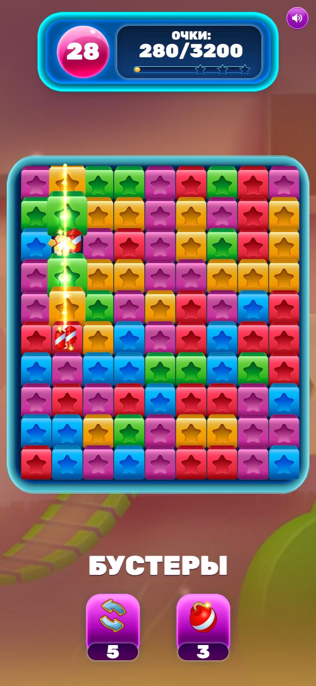
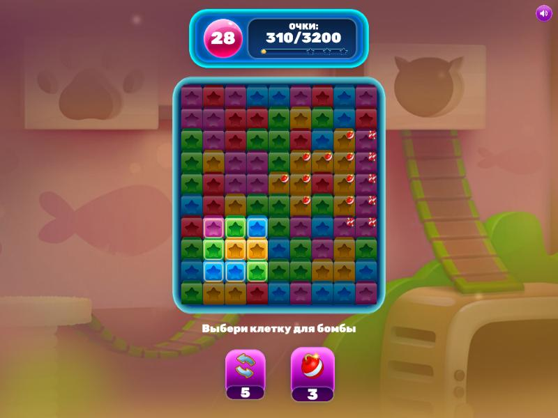
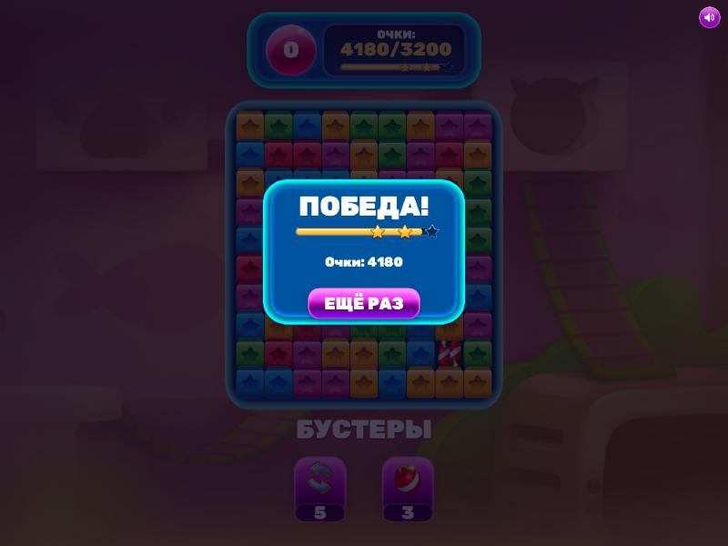

# Blast Puzzle

Прототип головоломки с механикой Blast на Cocos Creator 2.4.15 и TypeScript.

Играть в браузере: https://matbcontrol.github.io/blast-puzzle/ (десктоп и телефон). Параметр `?seed=42` в адресе повторяет ту же партию.

<table>
  <tr>
    <td rowspan="2"></td>
    <td></td>
  </tr>
  <tr>
    <td></td>
  </tr>
</table>

## Что сделано

Основное задание и все четыре дополнительных:

- клик сжигает группу соседних тайлов одного цвета (от двух), остальные падают, сверху досыпаются новые;
- счётчик ходов и очков, победа при наборе цели, поражение, когда кончились ходы или на поле не осталось групп;
- автоматическое перемешивание мёртвого поля, до трёх раз за уровень;
- бустер «бомба» сжигает квадрат вокруг клетки, бустер «телепорт» меняет местами два тайла;
- супер-тайлы за большие группы: сжигают строку, столбец, область или всё поле. Взрыв, задевший другой супер-тайл, запускает его.

Физический движок не используется и выключен в сборке.

## Запуск

Редактор: в Cocos Dashboard нажать Add Project и выбрать папку репозитория. В корне лежат и `project.json` от Cocos, и `package.json` с npm-инструментами, поэтому Dashboard спросит версию, нужно выбрать 2.x. Без Dashboard проект открывается так: `CocosCreator.exe --path <папка>`. Сцена: `assets/scenes/Game.fire`.

Проверки и инструменты:

```bash
npm ci
npm run check
```

`check` запускает проверку типов игры с API Cocos, проверку типов тестов и инструментов, ESLint и Jest. GitHub Actions на каждый пуш выполняет ту же команду.

```bash
npm run simulate
```

Боты играют уровень тысячу раз на настоящей модели и печатают распределение очков (подробнее в разделе про баланс).

Сборка для веба:

```bash
CocosCreator.exe --path . --build "platform=web-mobile;debug=false"
```

## Архитектура

Три слоя, зависимости направлены только вниз:

```
view/   Cocos-компоненты: поле, аниматоры шагов, HUD, бустеры, окно результата
  │
app/    контроллер и состояния ввода
  │
core/   модель игры
```

В `core/` и `app/` нет ни одного обращения к `cc`, в том числе в типах, это проверяет линтер. Поэтому модель и контроллер тестируются в Node без движка, а вью можно заменить целиком.

Как проходит ход:

1. `BoardView` переводит касание в клетку и отправляет сигнал `cellTapped`. Кликом считается касание, которое началось и закончилось на одной клетке, поэтому палец, проведённый по полю, ничего не сжигает.
2. Текущее состояние ввода решает, что значит этот клик: обычный ход, цель бустера или ничего, если идёт анимация.
3. `GameController` вызывает `BlastGame.tap()` или `useBooster()`.
4. Игра создаёт действие (`PlayerAction`), оно меняет поле. Затем игра сама досчитывает гравитацию, досыпку, очки, ходы и проверку мёртвого поля.
5. Наружу возвращается `TurnResult`: неизменяемый список шагов (сгорело, создан супер-тайл, упало, досыпалось, перемешалось) и новый прогресс.
6. `TurnPlayer` проигрывает шаги через аниматоры, по одному на тип шага. Досыпка начинается вместе с падением, а если падать нечему, ждёт, пока догорит взрыв. Пока шаги играют, ввод заблокирован. Если анимация упадёт, поле перерисуется из модели и игра продолжится.

Модель всегда опережает картинку на один ход и остаётся источником правды.

### Где здесь SOLID

- S: у каждого класса одна работа. `GroupRules` знает, что такое группа, `dropTiles` сдвигает столбцы, `LevelProgress` считает очки и ходы, `BurnResolver` разбирает цепные реакции.
- O: супер-тайлы, бустеры и аниматоры подключаются регистрацией. Новый вариант добавляется классом и строкой в точке сборки, код хода и ввода при этом не меняется (примеры ниже).
- L: любая `BurnArea` подставляется туда, где ждут зону взрыва. Бомба-бустер и супер-тайл «бомба» используют один класс `RadiusArea` с разным радиусом.
- I: интерфейсы узкие. Аниматорам доступен только `TileStage`, контроллеру только `BoardPresenter` и другие порты из `GameViews.ts`.
- D: контроллер зависит только от портов вью из `GameViews.ts` и не знает компонентов Cocos, это инверсия зависимостей. Модель получает свои части через конструктор из корня композиции, это внедрение зависимостей. Синглтонов нет.

Конкретные классы собираются в трёх местах: `BlastGameFactory.ts` собирает модель, `GameBootstrap.ts` подключает к ней контроллер и вью сцены, `BoardView.onLoad` регистрирует свои аниматоры.

Паттерны: Command (`PlayerAction`), Strategy (`BurnArea`, `ScoreFormula`), State (состояния ввода), Observer (`Signal`), Object Pool (`TileNodePool`), Factory (`TileFactory`, `TapActionFactory`).

### Как расширять

Новый супер-тайл: класс с интерфейсом `BurnArea`, имя в `SuperKinds` и строка `register` в `BlastGameFactory.ts`, спрайт в списке `TileSkins` в инспекторе и правило в `assets/configs/level1.json`. Про забытый спрайт игра скажет при старте.

Новый бустер: класс с `targetCount` и `createAction()`, строка `add` в фабрике, поле с числом зарядов в `LevelConfig`, `parseLevelConfig` и `level1.json`, кнопка в сцене. Код ввода менять не надо: `BoosterAimingInput` собирает столько клеток, сколько просит бустер. Поэтому бомбе с одной целью и телепорту с двумя хватает одного состояния.

Новый тип шага хода: интерфейс в `TurnStep.ts`, аниматор и строка `register` в `BoardView.onLoad`.

## Решения по спорным местам

- Группа сгорает от двух тайлов, как в Toon Blast.
- Очки. В нажатой группе k-й тайл стоит k × 10: два тайла дают 30, пять дают 150, десять дают 550. Тайлы, сгоревшие во взрыве, стоят по 10. Без этого разделения супер-тайл «всё поле» приносил бы около 41 000 очков за клик при цели в 3 200.
- Если цель набрана на последнем ходе, это победа.
- Клик по супер-тайлу тратит ход. Бустер тратит свой заряд, ход не тратит.
- Перемешиваний три на уровень. Каждое гарантирует, что после него есть ход: если случайная перестановка не дала группу, одна группа собирается обменом одноцветных тайлов. Четвёртое мёртвое поле означает поражение.
- Бомба бьёт квадратом (2R+1)×(2R+1), как в большинстве Blast-игр. У бустера R = 1, у супер-тайла R = 2.
- Супер-тайлы по размеру группы: от 6 строка или столбец, от 8 бомба, от 10 всё поле.
- Стартовое поле всегда имеет ход.
- Окно результата перехватывает касания, пока гаснет, и повторное нажатие «Ещё раз» в это время ничего не делает. Так второй тап двойного клика не попадает в новое поле и не запускает ещё одну партию.
- Генератор случайных чисел с сидом (mulberry32) передаётся в модель снаружи. Одинаковый сид даёт одинаковую партию, отсюда воспроизводимые тесты и `?seed=` в адресе. В продакшене это же позволило бы проверять ходы на сервере.

Все числа уровня лежат в `assets/configs/level1.json`, при загрузке они проверяются, и ошибки выводятся списком. Затем `GameBootstrap` сверяет уровень со сценой: у каждого цвета и супер-тайла должен быть спрайт в `TileSkins`, у каждого бустера ровно одна кнопка. Расхождения тоже выводятся списком, и игра не стартует.

## Баланс

Цель и число ходов подобраны симуляцией (`npm run simulate`, 1000 партий на стратегию). Боты играют на настоящей модели, допустимый ход берут из `GroupRules.canTap`, бустеры не используют:

| Бот                           | Медиана очков | Выигрывает при цели 3200 за 30 ходов |
| ----------------------------- | ------------- | ------------------------------------ |
| случайный                     | 2630          | 22%                                  |
| жадный (самая большая группа) | 3770          | 78%                                  |

## Производительность

Замеры в сборке web-mobile:

- 13 draw calls на всю сцену. Тайлы попадают в Dynamic Atlas, поэтому 90 тайлов не дают 90 вызовов. Статичный текст кэшируется в тот же атлас, меняющиеся числа в общий атлас символов.
- Ноды тайлов берутся из пула, во время каскадов новых объектов не создаётся.
- Сборка весит 1,34 МБ, из них движок 732 КБ. Неиспользуемые модули движка выключены. Фон пережат в JPG: прозрачности у него нет, 704 КБ превратились в 50 КБ.
- Экран: на высоком телефоне фиксируется ширина, на широком окне высота, фон растягивается на остаток (`ScreenFit`, `CoverBackground`). Полос по краям нет, поле всегда видно целиком.

## Особенности Cocos 2.4.15, о которые я споткнулся

- Редактор компилирует TypeScript 4.1 через `transpileModule`, без проверки типов. Синтаксис новее (`satisfies`, `override`) в нём не работает, а `for..of` по `Map` и `Set` молча выполняется ноль раз. `npm run typecheck` с target ES5 ловит такой `for..of`. ESLint запрещает синтаксис новее 4.1, потому что `tsc` и Jest здесь работают на TypeScript 5 и сами его пропустят.
- В `creator.d.ts` из поставки 2.4.15 не хватает запятой (строка 20916), и из-за этого `tsc` не проверяет семантику вообще. Исправленная копия лежит в `types/creator.d.ts`.
- Если в `builder.json` стоит ориентация `portrait`, шаблон web-mobile поворачивает игру на десктопе. Поэтому стоит `auto`, а портретную раскладку держит `ScreenFit`.
- Без `project.json` Dashboard по `package.json` записывает проект как 3.x и потом не перепроверяет. Если проект уже добавлен с неправильной версией: удалить его из списка с сохранением файлов и добавить заново.

## Ассеты

Графика из макета задания. Шрифт в макете Marvin, он платный, поэтому вместо него Rubik Black под лицензией OFL (`assets/fonts`).

## Что можно сделать дальше

- Уровни с разными целями (собрать N тайлов цвета, разбить препятствия): цель уровня уже отделена от правил хода.
- Подсказка после нескольких секунд бездействия: `GroupRules.canTap` уже отвечает, можно ли нажать клетку.
- Звук и частицы на взрывах.
- Сохранение прогресса и карта уровней.
